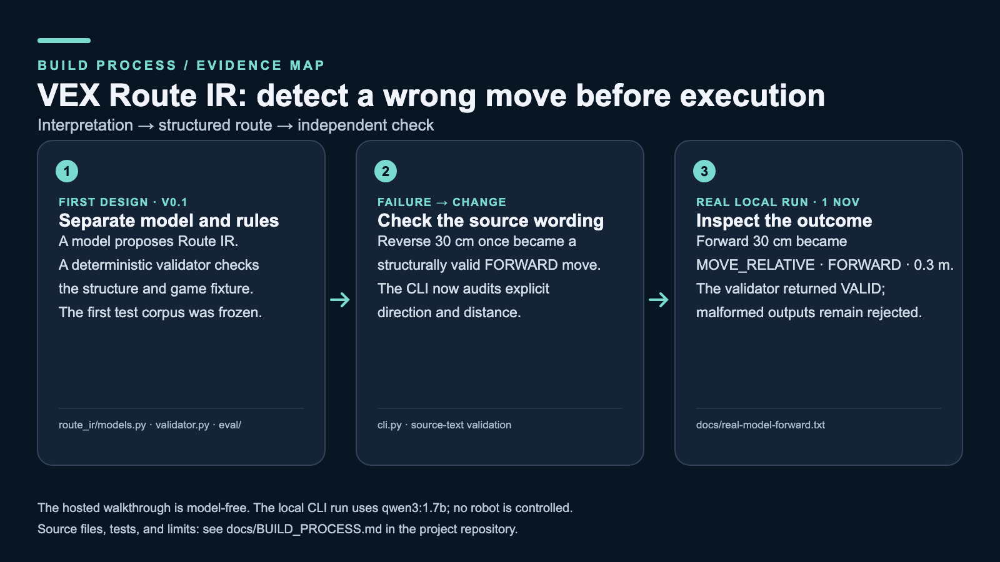

# VEX Route IR: build process evidence

The [portfolio guide](../PORTFOLIO.md) defines the scope and credits. This is a retrospective map of implementation decisions and observed checks, not an original sketch or a robot demonstration.

| Stage | Decision or observation | Inspect |
| --- | --- | --- |
| First design | Separate language interpretation from a structured Route IR and deterministic validation. A model's confident wording alone must not authorize a robot action. The original v0.1 test corpus was frozen rather than rewritten after model failures. | [v0.1 corpus guide](../eval/README.md), [schema](../route_ir/models.py), [validator](../route_ir/validator.py) |
| Direction error | A reverse 30 cm request once produced a structurally valid **forward** step. Schema validation could not detect that semantic mismatch, so the CLI now passes the source text into a narrow direction-and-distance audit. | [CLI](../cli.py), [source-text validation](../route_ir/validator.py), [focused tests](../tests/test_validator.py) |
| Current local check, 1 November 2026 | With `qwen3:1.7b`, a real local run interpreted “From blue left start, move forward 30 centimeters” as `MOVE_RELATIVE`, `FORWARD`, `0.3` meters; the validator returned `VALID`. A later reverse trial remained malformed and was rejected. The public browser walkthrough uses a deterministic parser and does not run Ollama. | [Captured forward CLI output](real-model-forward.txt), [browser prototype](index.html), [quick start](../README.md#try-it) |

The current system does not produce trajectories, motor commands, C++, or physical robot motion. The small model remains unreliable on some prompts; a rejected output is a useful safety result, not a completed route.
